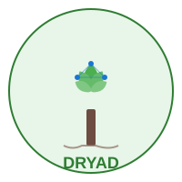

<div align="center">
  

# Project Dryad

**Smart Plant Health Monitoring System**

[](https://github.com/YOUR_USERNAME/dryad/actions/workflows/build.yml)
[](https://opensource.org/licenses/MIT)
[](https://github.com/espressif/esp-idf)

</div>

## 🌱 Overview

Project Dryad is a plant monitor for ESP32-C6, ESP32-C3, ESP32-S3, and ESP32-S2. Nodes share moisture and pump state over a Wi-Fi mesh with no router, and the Dryad phone app joins a node to watch, water, and configure it. MQTT is compiled in and left off until a broker exists.

## ✨ Features

- 📊 **Real-time Monitoring** - Soil moisture, temperature, humidity, and light sensing
- 📡 **Wi-Fi mesh** - Nodes relay status to each other with no home router
- 📱 **Phone app** - Expo app for monitor, pump control, and configuration
- 🔌 **MQTT, off by default** - Client is in the firmware; it connects only after you store a broker and turn the switch on
- 📧 **Email Alerts** - Automatic notifications when plants need water
- 🔋 **Battery Powered** - Extended operation with low-power design
- 💡 **Status LEDs** - Visual indicators for offline monitoring
- 🖥️ **Display Support** - I2C circular display (240x198) for local readings

## 🛠️ Hardware Requirements

| Component | Description | GPIO |
|-----------|-------------|------|
| ESP32-C6/C3/S3/S2 | Main controller. The enclosure uses a LOLIN ESP32-S2 Mini | - |
| Moisture Sensor | Capacitive soil moisture sensor | S2 Mini: GPIO1 · S3: GPIO4 · C3/C6: GPIO0 |
| Pump driver | Mini L298 ENA / IN1 (IN2 tied to GND) | GPIO6 PWM, GPIO10 direction |
| Display | [MSP0963 ST7789](https://2btrading.tn/accueil/9488-module-d-affichage-circulaire-096-240x198-msp0963-st7789-pour-raspberry-stm32-.html) | I2C pins |
| Environmental Sensors | Temperature, humidity, light | Various |
| Status LEDs | System status indicators | Configurable |

## 📦 Quick Start

### Prerequisites
- [ESP-IDF v5.5](https://docs.espressif.com/projects/esp-idf/en/latest/esp32/get-started/)
- Python 3.8+
- Git

### Installation

```bash
# Clone repository
git clone https://github.com/YOUR_USERNAME/dryad.git
cd dryad

# Setup ESP-IDF environment
source $IDF_PATH/export.sh  # Linux/macOS
# or
$IDF_PATH/export.bat        # Windows

# Configure target
idf.py set-target esp32c6   # or esp32c3

# Build and flash
./build.sh                  # Uses included build script
# or
idf.py build flash monitor  # Direct ESP-IDF commands
```

## 🏗️ Project Structure

```
dryad/
├── main/                   # Application source code
│   ├── main.c             # Entry point
│   ├── moisture_sensor.*  # Sensor implementation
│   └── display.*          # Display driver
├── .github/workflows/     # CI/CD automation
├── partitions.csv         # Factory image plus one OTA slot (mesh firmware)
├── sdkconfig.defaults     # Default configuration
└── build.sh              # Build helper script
```

## 🔧 Configuration

The phone app writes the plant name, pump thresholds, optional home Wi-Fi, and the MQTT switch into NVS. MQTT stays off until that switch is on and a broker URI is stored.

```bash
idf.py menuconfig
```

Key settings:
- **Sensor calibration** - Adjust DRY_VALUE and WET_VALUE for your sensor
- **Pump thresholds** - `PUMP_ON_BELOW_PERCENT` (35) and `PUMP_OFF_ABOVE_PERCENT` (45) in `main/pump.h`, also changeable from the app

## Pump

The firmware reads moisture every 2 seconds. Below 35% it enables the pump; at 45% or after 20 seconds it stops, then waits at least 60 seconds before it can run again. PWM is 70% so a small pump is not slammed to full speed.

Wire a mini L298 (one direction only):

| L298 pin | Connection |
|----------|------------|
| ENA | GPIO6 (1 kHz PWM) |
| IN1 | GPIO10 |
| IN2 | GND |
| OUT1 / OUT2 | Pump motor |
| +12 V / +5 V | Pump supply, not the 3.3 V pin |
| GND | ESP32 GND |

An L298 drops about 1.5–2 V and runs warm. For a one-way pump, a logic-level MOSFET (AO3400A, or IRLZ44N for a larger motor) plus a Schottky diode across the pump is smaller, cooler, and wastes less of the battery. Define `PUMP_DRIVER_MOSFET=1` and drive the gate from GPIO6; PWM then runs at 20 kHz. A TB6612FNG or DRV8870 module is the packaged version of that idea if you still want a module instead of a discrete MOSFET.

## Mesh, phone, and MQTT

Nodes form an ESP-WIFI-MESH named `DRYAD1` (password `dryad-mesh`) on channel 6. No home Wi-Fi is required. Each node broadcasts its moisture and pump state; neighbors remember it and relay a new sequence up to four hops. A phone joins that same network (up to three non-mesh clients) and talks HTTP to the node it associated with, at `http://192.168.4.1`.

| Request | Body | Effect |
|---------|------|--------|
| `GET /status` |  | This node, plus peers it has heard |
| `POST /cmd` | `{"t":"set","on":30,"off":55,"pwm":60}` | Pump thresholds. `on` must stay below `off` |
| `POST /cmd` | `{"t":"pump","run":1}` | `1` force on, `0` force off, `-1` automatic |
| `POST /cmd` | `{"t":"cfg","name":"Basil","mqtt":0,"broker":"","ssid":"","pass":""}` | Name, MQTT, optional home router |

A home SSID in `cfg` is optional. When it is set, the mesh root can join that router. Leave it empty to stay fully offline. Changing it restarts the node.

MQTT publishes `dryad/<node-id>/status` and subscribes to `dryad/<node-id>/cmd`, but only when `mqtt` is `1` and `broker` is a URI such as `mqtt://10.0.0.8`. The shipped default is `mqtt` `0` and an empty broker, so the client logs `MQTT present, left disabled` and does not open a socket.

The Android app lives in `dryad-app`. It polls `/status`, posts the commands above, and keeps the last snapshot in on-device storage so the last reading is still visible when the node is out of range. The MQTT switch in Configure ships off.

```bash
cd dryad-app
npm install
npx expo start
```

On the phone, join Wi-Fi `DRYAD1` / `dryad-mesh`, then open the app. The node address stays `192.168.4.1` unless you change it under Configure.

## 🚀 CI/CD

GitHub Actions builds every PlatformIO environment on pushes and pull requests to `main` and `dev`. Artifacts from those runs stay on the Actions tab.

## Releases

Pushing a tag that starts with `v` (for example `v1.0.0`) runs `.github/workflows/release.yml`. That workflow builds the Android APK and firmware for `esp32s3`, `esp32s2`, `esp32c3`, and `esp32c6`, then attaches them to a GitHub Release for that tag. You can also run the workflow by hand. If the version input is empty, the release tag is `dev-<short sha>`.

The release contains:

| File | Contents |
|------|----------|
| `dryad-android.apk` | Expo app from `dryad-app`. Signed with the debug keystore when no release keystore is configured, so it can be installed directly. Cleartext HTTP stays enabled. |
| `dryad-esp32s3.bin` | ESP32-S3 application, flash offset `0x10000` |
| `dryad-esp32s2.bin` | ESP32-S2 application for the LOLIN S2 Mini, flash offset `0x10000` |
| `dryad-esp32c3.bin` | ESP32-C3 application, flash offset `0x10000` |
| `dryad-esp32c6.bin` | ESP32-C6 application, flash offset `0x10000` |

Each chip also has `dryad-<chip>-bootloader.bin`, `dryad-<chip>-partitions.bin`, `dryad-<chip>-otadata.bin`, and `dryad-<chip>-flash.txt`. The flash note has the esptool command and the bootloader offset for that chip. `dryad-<chip>.elf` is attached only when it is 8 MiB or smaller. MQTT is still off in these images.

## 📤 Flashing Firmware

```bash
# Using idf.py (recommended)
idf.py -p /dev/ttyUSB0 flash

# Using esptool.py
esptool.py -p /dev/ttyUSB0 -b 460800 write_flash \
  0x0 build/bootloader/bootloader.bin \
  0x8000 build/partition_table/partition-table.bin \
  0x10000 build/dryad.bin
```

## 🐛 Troubleshooting

| Issue | Solution |
|-------|----------|
| Build fails | Ensure ESP-IDF is sourced: `source $IDF_PATH/export.sh` |
| Flash fails | Check port permissions: `sudo chmod 666 /dev/ttyUSB0` |
| Wrong readings | Calibrate sensor values in `moisture_sensor.c` |
| Monitor stuck | Exit with `Ctrl+]` |

## 🤝 Contributing

Contributions are welcome! Please feel free to submit a Pull Request.

## 📄 License

This project is licensed under the MIT License - see the [LICENSE](LICENSE) file for details.

## 🙏 Acknowledgments

- ESP-IDF team for the excellent framework
- Community contributors

---

<div align="center">
Made with 💚 for plant lovers
</div>